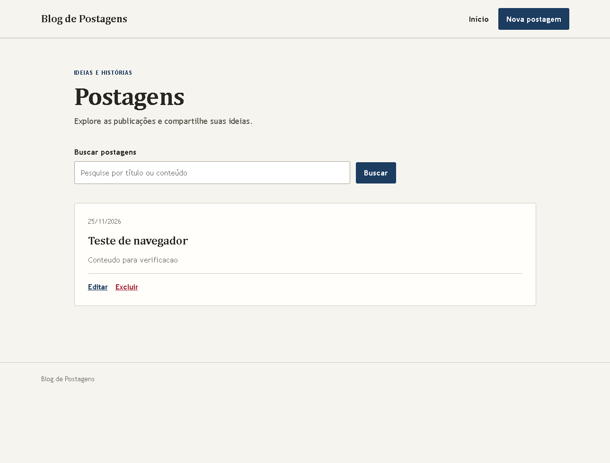
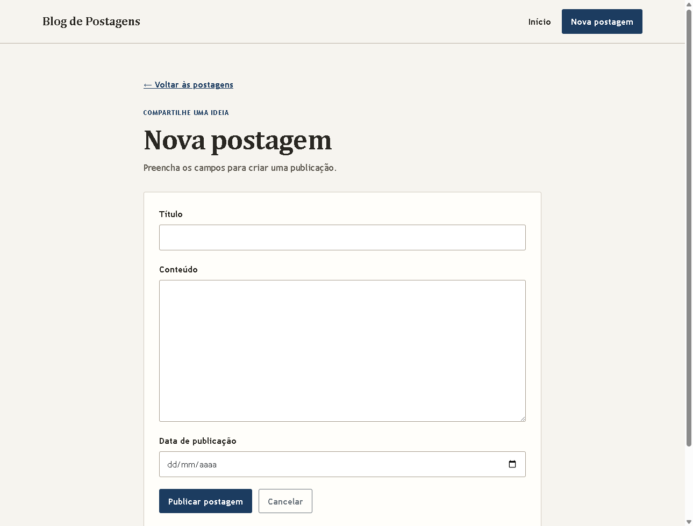

# Blog de Postagens

Blog para criar, editar, excluir, ler e pesquisar postagens.

Desenvolvido com PHP 8.4, MySQL, PDO, HTML, CSS, Bootstrap 5 e JavaScript.

## Baixar o projeto

```bash
git clone https://github.com/RodrigoTabaldi/Blog-de-Postagens.git
cd Blog-de-Postagens/blog
```

Os comandos a seguir devem ser executados na pasta `blog`.

## Executar com Docker

Com o Docker em execução:

```bash
docker compose up --build
```

Aguarde a inicialização e acesse http://localhost:8000. O banco e as postagens de exemplo são criados automaticamente na primeira execução. O Bootstrap é carregado pela internet.

Para parar, pressione `Ctrl+C` e execute `docker compose down`. Os dados permanecem salvos para a próxima execução. As senhas do Compose são apenas para uso local.

## Executar com PHP e MySQL

São necessários PHP 8.4 com as extensões `pdo_mysql` e `mbstring`, além do MySQL em execução. Use `php -m` para conferir as extensões e `php --ini` para localizar o arquivo de configuração do PHP.

Entre no MySQL com uma conta que possa criar o banco:

```bash
mysql --default-character-set=utf8mb4 -u root -p
```

No console do MySQL, crie o banco e, se quiser, importe as postagens de exemplo:

```sql
source database/schema.sql;
source database/seed.sql;
exit
```

A importação do `seed.sql` é opcional. Executá-la novamente duplica os exemplos.

Copie `config/database.example.php` para `config/database.php`:

```powershell
Copy-Item config/database.example.php config/database.php
```

No Linux ou macOS, use `cp config/database.example.php config/database.php`. No arquivo criado, informe os dados do MySQL. A conta da aplicação precisa de `SELECT`, `INSERT`, `UPDATE` e `DELETE` na tabela `blog.posts`. O arquivo de configuração é ignorado pelo Git.

Inicie o servidor:

```bash
php -S localhost:8000 -t public
```

Acesse http://localhost:8000. Para encerrar, pressione `Ctrl+C`.

## Telas



A página inicial mostra as postagens por data. É possível pesquisar pelo título ou conteúdo, abrir uma publicação, editar ou excluir.



No formulário, informe o título, o conteúdo e a data de publicação. Os mesmos campos ficam disponíveis para edição. Os dados são validados antes de serem salvos.

## Organização

Dentro da pasta `blog`, o projeto está organizado assim:

- `app/Controllers`: recebe as requisições e coordena as ações das postagens.
- `app/Models`: representa os dados de uma postagem.
- `app/Repositories`: reúne as consultas ao banco de dados.
- `app/Validators`: verifica os dados enviados nos formulários.
- `app/Database`: cria a conexão com o MySQL.
- `app/Views`: contém as páginas, os layouts e as mensagens de erro.
- `config`: contém os exemplos de configuração da conexão.
- `database`: contém o schema e as postagens de exemplo.
- `public`: é a pasta acessível pelo navegador; contém o ponto de entrada, os estilos e o JavaScript.
- `docs`: guarda as imagens usadas na documentação.
- `tests`: reúne os testes e seus resultados.

As instruções para os testes de aceitação estão em [blog/tests/aceitacao.md](blog/tests/aceitacao.md).

A aplicação não possui autenticação e foi preparada para execução local. Qualquer pessoa com acesso pode gerenciar as postagens.
